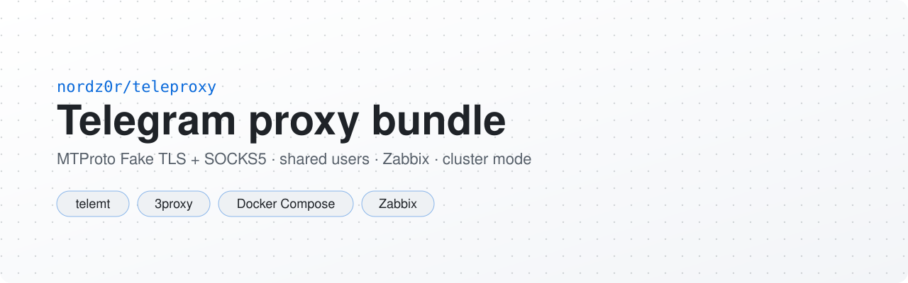

<p align="center">
  <picture>
    <source media="(prefers-color-scheme: dark)" srcset=".github/assets/banner-dark.svg">
    <source media="(prefers-color-scheme: light)" srcset=".github/assets/banner-light.svg">
    
  </picture>
</p>

<p align="center"><b>Русский</b> · <a href="README.en.md">English</a></p>

<p align="center">
  
  
  
  
  
  <a href="LICENSE"></a>
</p>

Набор прокси для Telegram: **MTProto (Fake TLS)** + **SOCKS5** с общим управлением пользователями, мониторингом в Zabbix и одной CLI-утилитой.

## Что внутри

| Сервис | Образ | Порт | Протокол |
|--------|-------|------|----------|
| [telemt](https://github.com/telemt/telemt) | `whn0thacked/telemt-docker` | 8443 | MTProto Fake TLS |
| [3proxy](https://github.com/3proxy/3proxy) | `3proxy/3proxy` | 48731 | SOCKS5 с авторизацией |

У обоих сервисов общие учётные данные. Пользователь, добавленный через `telemt-ctl`, сразу регистрируется и в MTProto, и в SOCKS5.

## Быстрый старт

### 1. Клонирование и настройка

```bash
git clone https://github.com/nordz0r/teleproxy.git /opt/teleproxy
cd /opt/teleproxy
cp .env.example .env
cp data/config.toml.example data/config.toml
```

Отредактируйте `.env`:
- задайте в `TELEPROXY_DOMAIN` домен вашего сервера;
- при необходимости переопределите `PUBLIC_HOST`, `TLS_DOMAIN`, `MTPROTO_PORT`, `SOCKS5_PORT`.

> ⚠️ Если Telegram у вас идёт через xray/sing-box (или другой L7-маршрутизатор, который смотрит на SNI),
> чужой `TLS_DOMAIN` вроде `www.google.com` может сломать MTProto:
> маршрутизатор отправит трафик по SNI на настоящий сайт, а не на ваш хост с telemt.
> Используйте свой домен, который указывает на сервер с telemt.

Сгенерировать или обновить поля хоста в `data/config.toml` из env:

```bash
./telemt-ctl config-sync-env
```

По умолчанию `telemt-ctl` читает `/opt/teleproxy/.env`, так что env-файл — источник истины
для генерируемых ссылок и для значений хоста, которые пишутся в `data/config.toml`.

### FAQ: домен из env и сертификаты

**В: Домен уже лежит в переменной окружения. Можно его переиспользовать?**  
Да. Используйте одно и то же значение в обоих местах:
- `TELEPROXY_DOMAIN` / `PUBLIC_HOST` (для ссылок, которые генерирует `telemt-ctl`);
- `TLS_DOMAIN` в `data/config.toml` через `telemt-ctl config-sync-env`.

Пример:

```bash
export TELEPROXY_DOMAIN=proxy.example.com
./telemt-ctl config-sync-env
./telemt-ctl list
```

Чтобы переопределить значения в текущем терминале или интерактивном shell,
экспортируйте их вручную или пропишите в `.env` / `~/.bashrc`:

```bash
export TELEPROXY_DOMAIN=proxy.example.com
export PUBLIC_HOST="$TELEPROXY_DOMAIN"
export MTPROTO_PORT=8443
export SOCKS5_PORT=48731
```

Если запускать `telemt-ctl` неинтерактивной SSH-командой вроде
`ssh root@host '/opt/teleproxy/telemt-ctl list'`, `~/.bashrc` может не загрузиться.
`telemt-ctl` обходит это, читая `/opt/teleproxy/.env` напрямую.
Если env у вас только в `~/.bashrc`, передайте переменные в команде или явно сделайте `source`.

После `./telemt-ctl config-sync-env` в `data/config.toml` должно быть:

```toml
[general.links]
public_host = "proxy.example.com"

[censorship]
tls_domain = "proxy.example.com"
```

**В: Нужен ли валидный TLS-сертификат для `tls_domain`?**  
Самому telemt для MTProto Fake TLS сертификат от публичного CA, как правило, **не нужен**.  
Но если перед ним стоит настоящий TLS-терминатор (Nginx/Caddy/CDN/reverse-proxy), этому слою, как обычно, нужен валидный сертификат.

### 2. Права

```bash
chown -R 65532:65532 data/
```

Контейнер telemt работает под UID 65532 (nonroot), и ему нужна запись, чтобы сохранять изменения пользователей через API.

### 3. Запуск

```bash
./telemt-ctl config-sync-env
docker compose up -d
```

### 4. Добавление пользователей

```bash
./telemt-ctl add alice
```

В выводе готовые ссылки `tg://proxy` и `tg://socks` для обоих протоколов.

### 5. Симлинк для удобства

```bash
ln -sf /opt/teleproxy/telemt-ctl /usr/local/bin/telemt-ctl
```

## telemt-ctl

Одна CLI-утилита для управления пользователями в обоих прокси.

### Управление пользователями

```bash
telemt-ctl add <username>      # добавить пользователя, вывести ссылки tg://
telemt-ctl del <username>      # удалить пользователя
telemt-ctl list                # все пользователи со ссылками
telemt-ctl link <username>     # ссылки одного пользователя
telemt-ctl stats [username]    # статистика подключений (всех или одного)
```

### Пример вывода

```
────────────────────────────────────────
 alice
  mtproto  tg://proxy?server=proxy.example.com&port=8443&secret=ee...
  socks5   tg://socks?server=proxy.example.com&port=48731&user=alice&pass=...
────────────────────────────────────────
 bob
  mtproto  tg://proxy?server=proxy.example.com&port=8443&secret=ee...
  socks5   tg://socks?server=proxy.example.com&port=48731&user=bob&pass=...
────────────────────────────────────────
```

### Переменные окружения

| Переменная | По умолчанию | Описание |
|------------|--------------|----------|
| `TELEPROXY_DOMAIN` | `proxy.example.com` | Общее значение по умолчанию для ссылок и TLS SNI |
| `PUBLIC_HOST` | `TELEPROXY_DOMAIN` | Имя хоста в генерируемых ссылках |
| `TLS_DOMAIN` | `TELEPROXY_DOMAIN` | TLS SNI, который пишется в `data/config.toml` |
| `MTPROTO_PORT` | `8443` | Порт MTProto в ссылках и конфиге |
| `SOCKS5_PORT` | `48731` | Порт SOCKS5 в ссылках |
| `TELEPROXY_ENV_FILE` | `/opt/teleproxy/.env` | Путь к env-файлу, который читает `telemt-ctl` |

Переопределение на один вызов: `PUBLIC_HOST=other.host telemt-ctl list`

## Мониторинг в Zabbix

### Установка UserParameters

```bash
cp zabbix/telemt.conf /etc/zabbix/zabbix_agent2.d/
systemctl restart zabbix-agent2
```

### Доступные элементы данных

| Ключ | Тип | Описание |
|------|-----|----------|
| `telemt.health` | Passive | 1 = работает, 0 = недоступен |
| `telemt.users.count` | Passive | Число пользователей |
| `telemt.conns.total` | Passive | Всего активных подключений |
| `telemt.octets.total` | Passive | Всего байт (B) |
| `telemt.ips.total` | Passive | Всего уникальных IP |

### LLD по пользователям

Правило обнаружения: `telemt.user.discovery`

Прототипы элементов:
- `telemt.user.conns[{#USERNAME}]`
- `telemt.user.octets[{#USERNAME}]`
- `telemt.user.ips[{#USERNAME}]`

Рекомендуемые теги: `component: telemt`, `mtproto_user: {#USERNAME}`

### Рекомендуемые триггеры

| Важность | Выражение |
|----------|-----------|
| High | `last(/host/telemt.health)=0` |
| Warning | `max(/host/telemt.conns.total,10m)=0` |

## Кластер (несколько серверов)

Teleproxy умеет автоматически реплицировать пользователей между серверами. Когда вы добавляете или удаляете пользователя на любом узле, изменение расходится по всем пирам через SSH.

### Настройка

1. **Настройте SSH-ключи** между серверами (доступ root):

```bash
# На каждом сервере нужен SSH без пароля ко всем пирам
ssh-copy-id root@node2.example.com
```

2. **Создайте конфиг пиров** на каждом сервере:

```bash
# На node1 — перечислить все ДРУГИЕ узлы
echo "node2.example.com" > /opt/teleproxy/data/peers.conf

# На node2 — перечислить все ДРУГИЕ узлы
echo "node1.example.com" > /opt/teleproxy/data/peers.conf
```

3. **Направьте DNS** на все узлы (round-robin A-записи):

```
tg.example.com  A  1.2.3.4    # node1
tg.example.com  A  5.6.7.8    # node2
```

### Использование

```bash
# Добавить пользователя — автоматически реплицируется на все пиры
telemt-ctl add alice

# Удалить пользователя — тоже реплицируется
telemt-ctl del alice

# Полная синхронизация — разослать локальное состояние на все пиры (добавить недостающих, удалить лишних)
telemt-ctl sync

# Проверить здоровье пиров
telemt-ctl peers

# Только локально (без репликации, используется внутри)
telemt-ctl --local add alice
```

### Как это работает

- `add`/`del` сначала выполняются локально, затем по SSH на каждом пире запускается `telemt-ctl --local`.
- `sync` считает локальный сервер источником истины: добавляет на пирах недостающих пользователей и удаляет лишних.
- На всех узлах пользователь создаётся с одним и тем же секретом, поэтому ссылки `tg://` работают независимо от того, какой сервер принял подключение.
- Если во время `add`/`del` пир недоступен, операция продолжается — потом запустите `sync`, чтобы выровнять расхождение.

## Архитектура

```
/opt/teleproxy/
├── docker-compose.yml
├── telemt-ctl              # скрипт управления
├── data/
│   ├── config.toml         # конфиг telemt (управляется через API)
│   ├── 3proxy.cfg          # конфиг SOCKS5
│   ├── socks5_passwd       # пользователи SOCKS5 (ведётся автоматически)
│   └── peers.conf          # пиры кластера (необязательно)
└── zabbix/
    └── telemt.conf          # UserParameters для Zabbix Agent 2
```

### Как устроено управление пользователями

`telemt-ctl add` делает два шага атомарно:
1. Вызывает API telemt (`POST /v1/users`) — добавляет пользователя в MTProto и сохраняет в `config.toml`.
2. Дописывает `user:CL:secret` в `socks5_passwd` для 3proxy.

Перезапуск контейнеров не нужен. API telemt применяет изменения на лету, а 3proxy перечитывает файл паролей при каждой попытке авторизации.

### Сеть

- **telemt** работает в bridge-режиме с пробросом портов.
- **socks5** работает в `network_mode: host` — это нужно для SOCKS5 UDP ASSOCIATE (3proxy должен открывать произвольные UDP-порты для ретрансляции).

## Важно: голосовые звонки

Встроенные настройки прокси в Telegram (и MTProto, и SOCKS5) **не поддерживают голосовые и видеозвонки**. Это [известное ограничение](https://github.com/telegramdesktop/tdesktop/issues/29665) клиента Telegram: он не реализует SOCKS5 UDP ASSOCIATE для трафика звонков.

**Что работает:**
- сообщения, медиа, стикеры, файлы — полностью работают через оба прокси;
- голосовые и видеозвонки — нужен системный VPN или внешний проксификатор (Nekobox, Shadowrocket, v2rayN).

## Требования

- Docker + Docker Compose v2
- `jq` и `xxd` на хосте (для `telemt-ctl`)
- Zabbix Agent 2 (необязательно, для мониторинга)

## Порты

| Порт | Протокол | Сервис |
|------|----------|--------|
| 8443 | TCP | MTProto Fake TLS |
| 48731 | TCP+UDP | SOCKS5 |
| 9090 | TCP (localhost) | Метрики Prometheus |
| 9091 | TCP (localhost) | API управления telemt |

## Лицензия

MIT, см. [LICENSE](LICENSE).

## Ссылки

- [telemt](https://github.com/telemt/telemt) — MTProto-прокси для Telegram (Rust + Tokio)
- [telemt-docker](https://github.com/An0nX/telemt-docker) — Docker-образ telemt
- [3proxy](https://github.com/3proxy/3proxy) — маленький бесплатный прокси-сервер
- [Проблема со звонками](https://github.com/telegramdesktop/tdesktop/issues/29665) — звонки не работают через встроенный прокси
